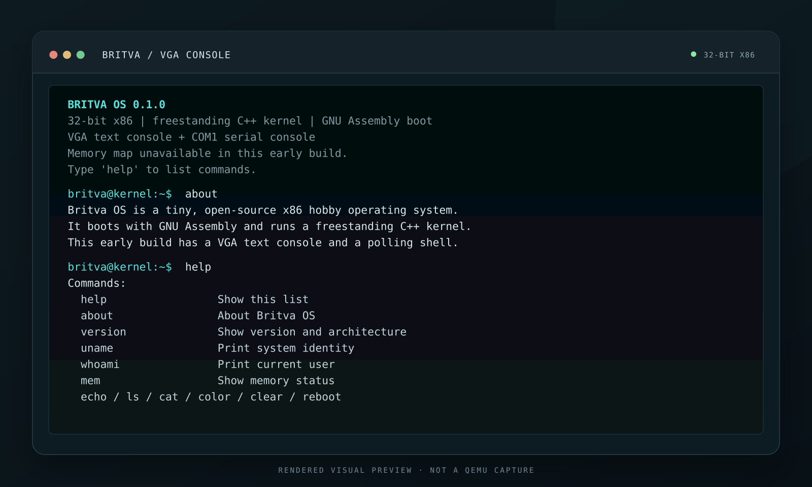
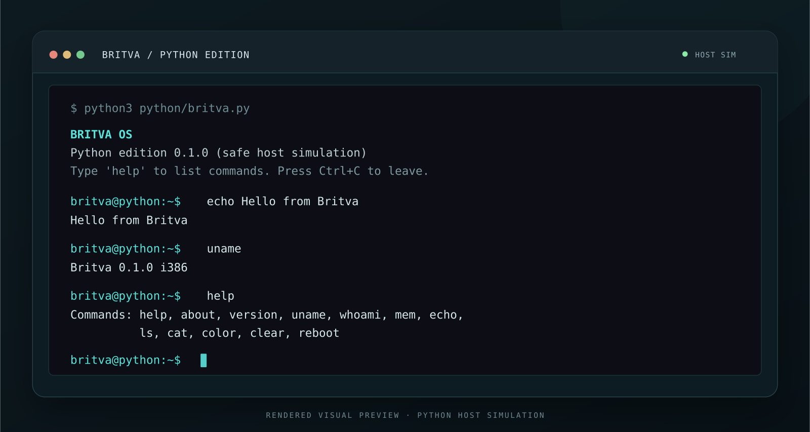

# Britva OS

**Britva OS** is a tiny, bootable 32-bit x86 hobby OS made for learning how a computer starts. A real-mode GNU Assembly boot sector loads a freestanding C++ kernel, which switches to protected mode and opens a small VGA/serial command console. A safe Python shell simulation and an interactive browser preview are included too.

> **Status:** early educational prototype (`0.1.0`). It is BIOS/legacy-BIOS only, has no filesystem or multitasking, and is not intended as a daily-use operating system.

## Previews

### Kernel console



### Python edition



These are **rendered UI previews, not screenshots captured from a QEMU boot**; editable SVG sources sit beside the PNGs. The bootable image is built below, and QEMU is not bundled with this repository. The browser demo is also a UI/shell preview, not a hardware emulator.

## What is in the repository?

- **Assembly boot sector** (`boot/boot.S`): BIOS floppy CHS reads, A20 enable, flat GDT, and 32-bit protected-mode handoff.
- **C++ kernel** (`kernel/`): freestanding i386 code; VGA text output, COM1 serial mirror/input, polled US-layout PS/2 keyboard, and a small shell.
- **Python edition** (`python/britva.py`): matching educational commands in a safe host-side simulator. It never invokes host shell commands or reboots the host.
- **Browser preview** (`preview/index.html`): a self-contained interactive demo with no external assets or dependencies.

The kernel currently supports `help`, `about`, `version`, `uname`, `whoami`, `mem`, `echo`, `ls`, `cat`, `color`, `clear`, and `reboot`. A few hardware-related commands intentionally report that the feature is not implemented yet.

## Build the boot image

### Requirements

- Linux x86 host with GNU `g++`, GNU binutils (`as`, `ld`, `objcopy`), GNU Make, and Python 3.
- QEMU (`qemu-system-i386`) to boot the image. QEMU is optional for building and testing the Python edition.

On Debian/Ubuntu, for example:

```sh
sudo apt install build-essential binutils make python3 qemu-system-x86
```

Build a 1.44 MB raw floppy image:

```sh
make
```

The output is `build/britva-os.img`. This is a legacy BIOS floppy image, not an ISO and not a UEFI boot image.

Boot with a VGA window and a mirrored serial console:

```sh
make run
```

Or use the terminal-backed COM1 console:

```sh
make run-serial
```

In the serial run, type commands into the terminal; use **Ctrl+A**, then **X** to quit QEMU.

## Python edition

```sh
python3 python/britva.py
```

Run one command without entering the interactive shell:

```sh
python3 python/britva.py --command "echo Hello from Britva"
```

Show a short scripted demo:

```sh
python3 python/britva.py --demo
```

The Python edition is a command-shell simulation—not a Python kernel—and is intentionally isolated from the host OS.

## Browser preview

Start a local static server:

```sh
make preview
```

Then open `http://localhost:4173`. The page's command responses are simulated in the browser; it does not emulate the CPU or access the host machine.

## Tests

```sh
make test
```

The tests cover the Python shell and raw-image builder. With QEMU installed, `make qemu-test` boots the image and checks that the COM1 shell answers commands; `make run-serial` starts an interactive session.

## Current limitations

- 32-bit x86 and legacy BIOS only; no UEFI, paging, interrupts, user mode, scheduler, or filesystem.
- The boot sector reads a fixed 64-sector kernel window; the build rejects a kernel that exceeds it.
- The shell uses polling input and supports a basic US-layout PS/2 keyboard.
- The kernel does not yet receive a BIOS memory map, so `mem` reports that information as unavailable.
- `reboot` is implemented only in the bare-metal kernel; the Python edition reports that it cannot reset the host.

## License

MIT. See [LICENSE](LICENSE).
